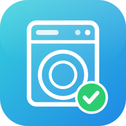
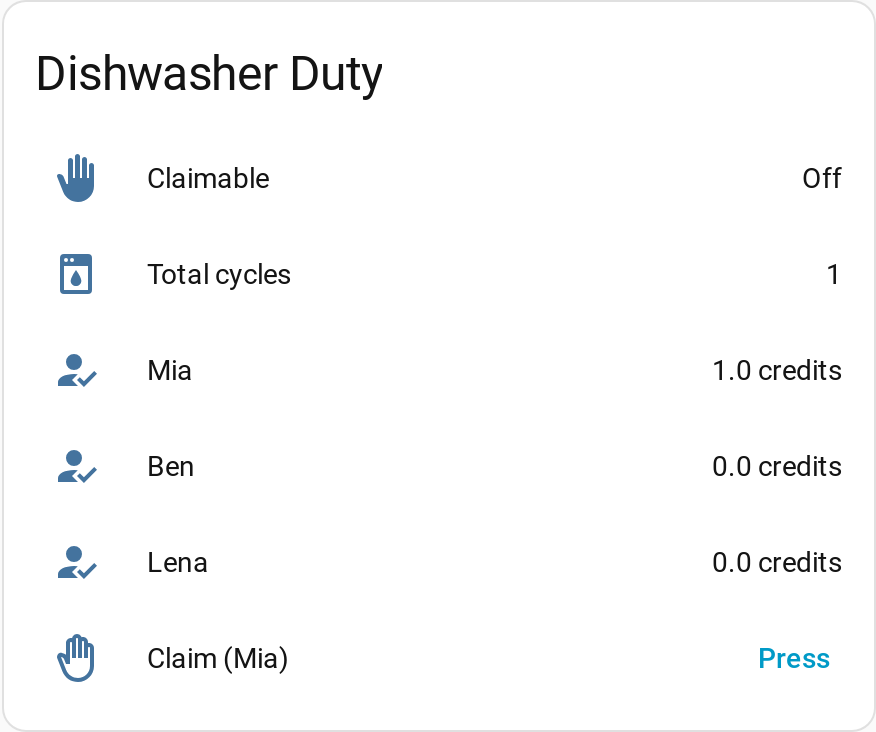
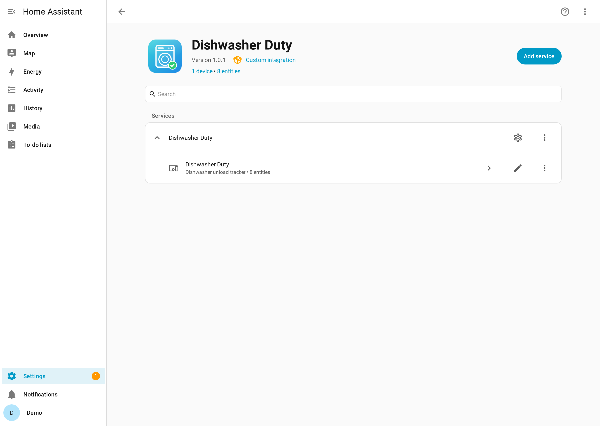
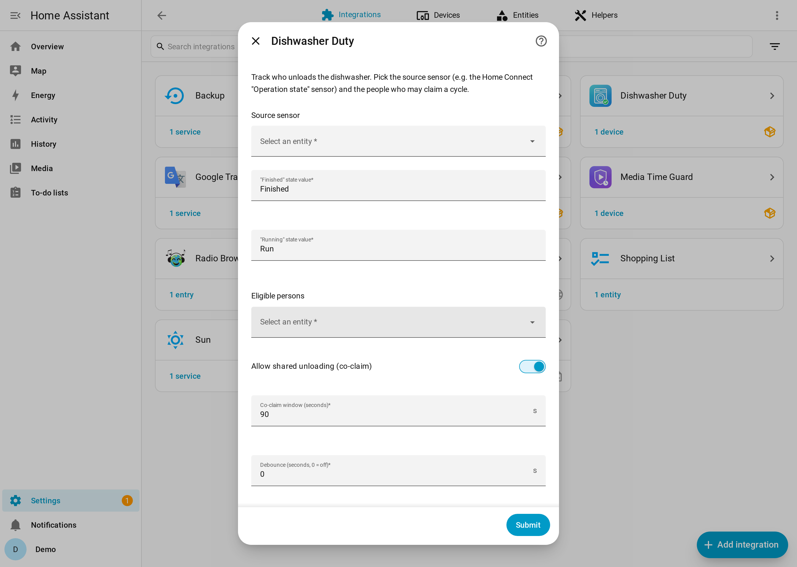

> 🇬🇧 English (this page) · 🇩🇪 [Deutsch](README.de.md)

<p align="center">
  
</p>

# Dishwasher Duty

**A Home Assistant integration that records who unloaded the dishwasher after each finished
programme, splits the credit fairly when several people helped, and keeps per-person statistics.**

[](https://github.com/hacs/integration)
[](https://github.com/Jo-Highness/dishwasher_duty/actions/workflows/validate.yml)
[](https://github.com/Jo-Highness/dishwasher_duty/actions/workflows/test.yml)
[](https://github.com/Jo-Highness/dishwasher_duty/releases)
[](LICENSE)
[](https://www.home-assistant.io/)

## Quick start

You need a sensor that reports your dishwasher's programme state — for example the
*Operation state* sensor of the [Home Connect](https://www.home-assistant.io/integrations/home_connect/)
integration — and at least one `person` in Home Assistant.

1. **Install via HACS:**
   [](https://my.home-assistant.io/redirect/hacs_repository/?owner=Jo-Highness&repository=dishwasher_duty&category=integration)
   — download *Dishwasher Duty* and restart Home Assistant.
2. **Add the integration:** *Settings → Devices & services → Add integration → "Dishwasher Duty"*.
   Pick the source sensor, then the "running" and "finished" values (offered from the sensor —
   for Home Connect `run` and `finished`) and the people who unload.
3. **Try it without waiting for a programme:** open *Developer tools → States*, select your
   source sensor, set its state to `run` (*Set state*), then to `finished`.
   `binary_sensor.dishwasher_duty_claimable` turns **on**.
4. **Claim it:** press `button.dishwasher_duty_claim_<person>` (e.g. on a dashboard). The person's
   sensor `sensor.dishwasher_duty_<person>` now shows **1.0 credits**.
5. Optional: remove the test cycle again with the action `dishwasher_duty.reset_statistics`
   (without a person it clears **all** history — fine right after installation).

> States set in *Developer tools* are only temporary; the real sensor overwrites them with its
> next update.

## Screenshots

> Captured from a demo Home Assistant with fictional data (version 1.0.x — the setup form is
> now split into two steps, see [Configuration](#configuration)).

| Entities card | Integration page |
|:---:|:---:|
|  |  |

| Setup form (1.0.x) |
|:---:|
|  |

## How it works

The integration watches the **source sensor**. When its state changes from the *running* value to
the *finished* value, a **claimable cycle** opens. Whoever unloads the machine presses their
button (or calls an action) and receives the credit for that cycle: **1.0 per cycle**. If shared
unloading (co-claim) is on, other people can join within a time window after the first claim and
the 1.0 is split among them.

- **Cycle detection:** only a change *running → finished* counts. `finished → finished` or
  `unavailable → finished` (without a preceding run) does not.
- **`unavailable`/`unknown` are ignored:** if the sensor drops out during a programme
  (*run → unavailable → finished*), the cycle still counts — also across a Home Assistant restart.
- **Case does not matter:** `Run`, `run` and `RUN` are the same value.
- **Persistence:** the cycle history and an open claim window (with its remaining time) survive
  restarts.
- **Statistics:** credits per person in total and for today/week/month/year; the sensors have
  `state_class: total_increasing`, so they work with history graphs and long-term statistics.
- **Several dishwashers:** each dishwasher is its own entry with its own entities.
- UI translated into German, English, Spanish, French, Greek, Japanese and Norwegian Bokmål.

## Installation

### HACS (recommended)

1. Click the HACS button in the [Quick start](#quick-start), or in HACS go to ⋮ →
   *Custom repositories* and add `https://github.com/Jo-Highness/dishwasher_duty` with type
   **Integration**.
2. Download *Dishwasher Duty* and restart Home Assistant.

### Manual

Copy `custom_components/dishwasher_duty/` into `<config>/custom_components/` and restart Home
Assistant.

## Configuration

Setup has two steps; both can be changed later via the entry's **Configure** button.

**Step 1 — source sensor**

| Field | Meaning |
|---|---|
| **Source sensor** (`source_sensor`) | A `sensor` entity that reports the programme state, e.g. `sensor.dishwasher_operation_state` (Home Connect). Each sensor can only be used by one entry. |

**Step 2 — states, persons, co-claiming**

| Field | Meaning |
|---|---|
| **"Running" state value** (`running_value`) | State while a programme runs. Default `run`. |
| **"Finished" state value** (`finished_value`) | State at the end of a programme. Default `finished`. |
| **Eligible persons** (`persons`) | One or more `person` entities. Each gets a claim button and a credit sensor. |
| **Allow shared unloading** (`allow_co_claim`) | On (default): others can join after the first claim. Off: the first claim gets the full credit immediately. |
| **Co-claim window** (`co_claim_window`) | Seconds after the first claim during which others can join, 5–600 (default 90). |
| **Debounce** (`debounce_seconds`) | Ignore another finished cycle within this many seconds of the previous one, 0–120 (default 0 = off). |

The two state fields are drop-downs filled from the sensor's list of possible states (its
`options` attribute). If your sensor has no such list, or you need another value, just type it
in. Comparison is case-insensitive.

> **Home Connect:** since Home Assistant 2025.1 the *Operation state* sensor reports lowercase
> values such as `run` and `finished`. Entries created with the old defaults `Run`/`Finished`
> keep working, because values are compared without regard to case.

## Entities

All entities belong to one service device per dishwasher, named after the entry
(**Dishwasher Duty** for the first one).

| Entity | Meaning |
|---|---|
| `binary_sensor.dishwasher_duty_claimable` | `on` while the current cycle can still be claimed. Attributes: `claim_open_since`, `co_claim_window_until`, `current_claimers` |
| `sensor.dishwasher_duty_total_cycles` | Number of finished cycles, claimed or not. Attributes: `last_cycle_finished`, `current_cycle_claimed_by`, `last_claim_credits` |
| `sensor.dishwasher_duty_<person>` | Credits of one person, unit `credits`. Attributes: `credits_total`, `credits_today`, `credits_this_week`, `credits_this_month`, `credits_this_year`, `claims_count_total`, `last_claim`, `person` |
| `button.dishwasher_duty_claim_<person>` | "I unloaded it" — claims the open cycle for this person |

`<person>` is the object id of the `person` entity (`person.mia` → `…_mia`). A second dishwasher
gets its own prefix, e.g. `sensor.dishwasher_duty_kitchen_dishwasher_total_cycles`.

When you remove a person from the configuration, their sensor and button are removed as well.

## Actions (services)

Wherever a person is expected you can pass the entity ID (`person.mia`), its object id (`mia`)
or the display name (`Mia`), case-insensitive.

| Action | Fields | Description |
|---|---|---|
| `dishwasher_duty.claim` | `person` | Claim the open cycle for one person. |
| `dishwasher_duty.claim_multiple` | `persons` | Claim for several people at once (credit shared equally). |
| `dishwasher_duty.cancel_claim` | `person` | Withdraw a claim while the window is open. Fails with an error if no cycle is open. |
| `dishwasher_duty.get_statistics` | `start`, `end`, `person` (all optional) | Statistics as an **action response**. |
| `dishwasher_duty.reset_statistics` | `person` (optional) | ⚠️ Deletes history: everything, or only this person's claims and credits. |

Every action also has an optional **`config_entry_id`** field to select one dishwasher. Without
it, claims go to the dishwasher(s) where the person is configured and `reset_statistics` affects
all dishwashers. `get_statistics` needs it as soon as more than one dishwasher is set up.

**Statistics example:**

```yaml
action: dishwasher_duty.get_statistics
data:
  start: "2026-01-01 00:00:00"
  end: "2026-12-31 23:59:59"
response_variable: stats
```

`stats` contains `start`, `end`, `total_cycles`, `unclaimed_cycles`, `per_person`
(`participations` and summed `credits` per person) and a chronological `timeline` of cycles.

## Automation examples

**1. Tell the household when a cycle is waiting to be claimed**

```yaml
alias: "Dishwasher finished — who's unloading?"
triggers:
  - trigger: state
    entity_id: binary_sensor.dishwasher_duty_claimable
    to: "on"
actions:
  - action: notify.family
    data:
      title: "Dishwasher done 🍽️"
      message: "It's clean! Press your button once you've unloaded it."
```

**2. Nudge again if nobody has claimed after 30 minutes**

```yaml
alias: "Dishwasher still not claimed"
triggers:
  - trigger: state
    entity_id: binary_sensor.dishwasher_duty_claimable
    to: "on"
    for:
      minutes: 30
actions:
  - action: notify.family
    data:
      message: "The dishwasher is still full 👀 — claim it when you empty it."
```

`notify.family` is a placeholder — use one of your own notify actions.

**Example dashboard**

```yaml
type: vertical-stack
cards:
  - type: entities
    title: Dishwasher
    entities:
      - entity: binary_sensor.dishwasher_duty_claimable
        name: Ready to unload?
      - entity: sensor.dishwasher_duty_total_cycles
        name: Total cycles
      - entity: button.dishwasher_duty_claim_mia
        name: Mia did it
      - entity: button.dishwasher_duty_claim_ben
        name: Ben did it
  - type: history-graph
    title: Credits
    entities:
      - sensor.dishwasher_duty_mia
      - sensor.dishwasher_duty_ben
```

## How credit is split

- **One credit per cycle = 1.0.** With n claimers everybody gets ⌊100/n⌋ hundredths (rounded
  down); the remaining hundredths go to the first claimers, so the sum is always exactly 1.00
  (3 people → 0.34 / 0.33 / 0.33).
- **Timing:** credits count for the moment the cycle was finalised (`claimed_at`).
- **The window closes** when the next programme starts (the *running* value), not when the
  machine goes to `ready`/`unavailable` — so you can still claim after the machine switched off.
  If people had claimed, the cycle is finalised; otherwise it stays unclaimed but is still counted.

## Troubleshooting / FAQ

- **Nothing happens when the dishwasher finishes.** Check the state values: open *Developer
  tools → States*, look at your source sensor during and after a programme and compare with the
  values in the entry's options. Upper/lower case does not matter.
- **The sensor was `unavailable` in between.** `unavailable` and `unknown` are ignored and do not
  replace the last real state. *run → unavailable → finished* is counted as one cycle;
  *unavailable → finished* without a preceding run is not.
- **A repair says the source sensor is missing.** The entity no longer exists (e.g. renamed or
  the device was re-added). Open the entry's options and select the new sensor. The repair
  disappears once the sensor exists again.
- **A restart won't lose an open window.** It is restored with its remaining time; if it expired
  during the restart, the cycle is finalised right away.
- **Pressing a button twice does nothing extra.** One contribution per person and cycle.
- **`cancel_claim` reports an error.** There is no open cycle at the moment.
- **My period values changed at midnight.** Only today/week/month/year roll over; the total
  never changes at midnight.

**Debug logging:**

```yaml
logger:
  logs:
    custom_components.dishwasher_duty: debug
```

**Diagnostics:** *Settings → Devices & services → Dishwasher Duty → ⋮ → Download diagnostics*
(person entity IDs are replaced by placeholders).

## Upgrading to 1.1.0

- Minimum Home Assistant version is now **2025.2**.
- Entity IDs, unique IDs, action names/fields and the stored history are unchanged. Entity names
  are now translated; entity IDs you renamed yourself stay as they are.
- The friendly name of the cycle counter changes from "… Total Cycles" to "… Total cycles".
- `cancel_claim` without an open cycle now returns an error instead of silently doing nothing.
- `get_statistics` requires `config_entry_id` when more than one dishwasher is set up.

## Further documentation

- Technical documentation: [`docs/TECHNICAL.md`](docs/TECHNICAL.md)
- User guides: [`docs/user/`](docs/user) (de, en, es, fr, nb, el, ja)
- Changes: [`CHANGELOG.md`](CHANGELOG.md)

## Contributing

Contributions are welcome! Please read [`CONTRIBUTING.md`](CONTRIBUTING.md) and open an issue or
pull request on the [issue tracker](https://github.com/Jo-Highness/dishwasher_duty/issues).

## License

Released under the [MIT License](LICENSE).

## Credits

Created and maintained by [@Jo-Highness](https://github.com/Jo-Highness). Built for
[Home Assistant](https://www.home-assistant.io/) and distributed via [HACS](https://hacs.xyz/).
